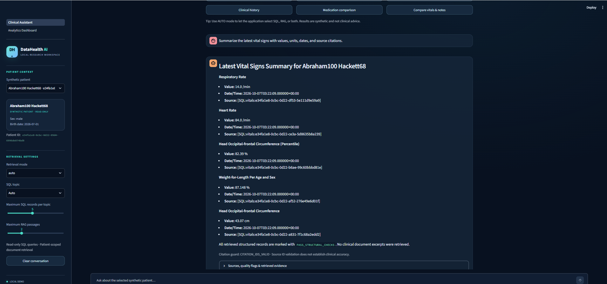
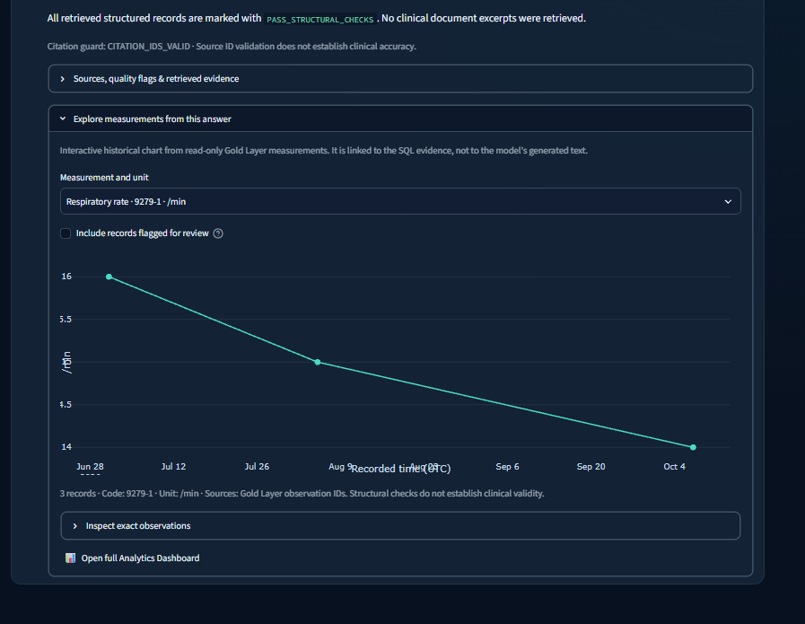
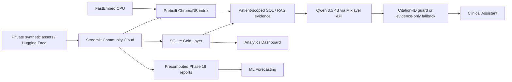

# DataHealth AI

**Data that connects. Insights you can trace.**

**DataHealth AI** is an end-to-end educational platform combining **synthetic HL7 FHIR R4 healthcare data**, quality-aware data engineering, patient-scoped SQL and RAG, LLM-assisted retrieval, interactive analytics, and exploratory operational forecasting.

### [Launch the live DataHealth AI application](https://datahealth-ai.streamlit.app/)

[**Streamlit Cloud demo**](https://datahealth-ai.streamlit.app/) · [Deployment source](https://github.com/LucaBarsi/DataHealth-AI/tree/deployment/streamlit-full-112) · [Technical documentation](docs/)

**Project status — November 27, 2026:** a **112-patient synthetic-data application is deployed** on Streamlit Community Cloud. The local Python/SQLite/Ollama project and the separate Ubuntu/WSL 2 Spark workflow remain available for experimentation. The app is deployed from `deployment/streamlit-full-112`, while the GitHub `main` branch retains the local engineering baseline. **The GitHub source repository is public**, and the web application is available separately on Streamlit Community Cloud.

> [!IMPORTANT]
> **Synthetic data only.** This is a research and portfolio prototype, **not** a clinical decision-support system. Never enter real patient information or use outputs for diagnosis, treatment, monitoring, or medical decisions. Valid citation IDs and structural quality checks do **not** establish factual or clinical correctness.

## Explore the live application

| Page | What it demonstrates |
|---|---|
| **DataHealth AI (Clinical Assistant)** | Select one of 112 synthetic patients; ask questions in English using auto, SQL, RAG, or hybrid retrieval; inspect source IDs, evidence, quality flags, and evidence-linked measurements |
| **Analytics Dashboard** | Explore synthetic patient, encounter, observation, and data-quality summaries through interactive charts |
| **ML Forecasting** | Review exploratory, aggregate monthly encounter forecasts based on synthetic data; **not** patient-level risk prediction |

**Hosted architecture:** Python 3.12 on Streamlit Community Cloud, with a read-only synthetic SQLite Gold Layer, a prebuilt ChromaDB index, **FastEmbed CPU query embeddings**, and **Qwen 3.5 4B inference via Mixlayer**. Data/index/report archives come from a private Hugging Face dataset, with checksum validation at startup.

The public prototype has best-effort **6 model calls/session**, **15 seconds between calls**, and **24 model calls/hour per Python process**. These are *not* hard account-wide API quotas. Missing/invalid citations or model unavailability can trigger an evidence-only response. Cloud model initialization may slow the first question.

## Why this project exists

The fictional **DataHealth** organization represents a common health-data challenge: records, measurements, documents, and operational events are dispersed across systems. This prototype explores how to ingest a synthetic FHIR sample, preserve provenance and quality indicators, retrieve patient-specific evidence, and present interpretable analytics **without using real patient information**.

The project has a local engineering pipeline and an independent Spark/Parquet experimentation path. It does **not** ingest live sensors, integrate with actual hospitals, use Kafka streaming, or deploy managed Azure/AWS services.

## Application preview

### Clinical Assistant

Select one synthetic patient, ask a question in English, use SQL/RAG/hybrid retrieval (or automatic routing), and inspect cited evidence with quality flags. **Local inference** uses Qwen 3.5 4B through **Ollama**; **hosted inference** uses Qwen 3.5 4B via the **Mixlayer API**.



### Analytics Dashboard

Explore aggregate or patient-filtered synthetic records, observation activity, measurement categories, data-quality findings, and operational summaries.


### Evidence-linked contextual measurements — Phase 21

For eligible structured answers, the Clinical Assistant re-queries **read-only SQLite Gold Layer data** instead of plotting numbers produced by the LLM. Results are restricted to the selected synthetic patient and grouped by **measurement code and unit**:

- **Two or more eligible observations:** an interactive time-series chart.
- **One eligible observation:** a single-value display with unit, UTC date/time, quality status, and observation ID; no trend is implied.
- **No eligible observations:** an explanation rather than a fabricated chart.
- Records marked `REVIEW_REQUIRED` are **excluded by default** and included only when the user enables the review filter.



*Screenshots show earlier local versions of the interface and may differ from the latest hosted UI.*

### Operational ML forecasting — Phase 18

The project includes an **exploratory workload-forecasting** module and Streamlit ML Forecasting page (`src/workload_forecast.py` and `pages/2_ML_Forecasting.py`). This work concerns operational aggregates; it is **not** a clinical prediction or patient-risk model. See [Phase 18 notes](docs/development_history/README_PHASE18.md) and [forecasting methodology](docs/phase18_workload_forecasting.md).

## Implemented capabilities and scope

| Area | Implemented capability | Important boundary |
|---|---|---|
| **FHIR ingestion and quality** | Selected Synthea FHIR R4 resources, metadata auditing, Python transformations, structural review flags | Not complete FHIR conformance or clinical validation |
| **Gold Layer and analytics** | Relational SQLite database, predefined patient-scoped/read-only SQL queries, Streamlit and Plotly dashboards | No multi-user access control |
| **Document RAG** | Selected current synthetic notes, `nomic-embed-text` embeddings via Ollama, ChromaDB, patient-scoped retrieval | Source retrieval alone does not prove each answer is correct |
| **Source-aware assistant** | Qwen 3.5 4B with SQL, RAG, and hybrid retrieval; citation-ID checks and evidence-only fallback | Citation-ID validity is not claim-level factual validation |
| **Contextual charts (Phase 21)** | Evidence-linked measurement history, single-observation summary, unit isolation and quality filter | No clinical interpretation of values |
| **Local Spark ETL (Phase 19)** | Separate Ubuntu/WSL 2 workflow using PySpark 4.3.0 and Silver/Gold Parquet outputs | Not a production distributed cluster |
| **Pipeline consistency audit (Phase 20)** | Read-only checks comparing synthetic FHIR Bundle counts, Spark Parquet aggregates, and an optional SQLite summary | Structural/count consistency, not clinical correctness |
| **Operational forecasting (Phase 18)** | Local ML experimentation and dashboard page | Not patient-level risk prediction |
| **Power BI preparation** | Export module and guidance for downstream reporting | Does not mean a Power BI dashboard or service is deployed |
| **Hosted web demo** | Streamlit Cloud serving 112 synthetic patients; read-only SQLite and ChromaDB; Mixlayer Qwen inference; FastEmbed CPU query embeddings | No real clinical data or production-grade authorization; query embeddings approximate the Ollama-generated index |

## System architecture

### Hosted Streamlit deployment

The live application uses **precomputed** synthetic assets; it does not run ingestion, Spark training, or index construction in Streamlit Cloud.



The ChromaDB index was originally built using Ollama `nomic-embed-text`; hosted FastEmbed `nomic-ai/nomic-embed-text-v1.5-Q` is an **experimental query embedding compatibility approach**, not identical inference or a clinical retrieval guarantee.

### Local application and Spark experiment

The local application combines the **Python/SQLite pipeline** with **Ollama**, while Spark/Parquet experiments are performed separately under Ubuntu/WSL 2. These are not a managed production lakehouse.

```mermaid
flowchart TD
    A["Synthea — synthetic FHIR R4"] --> B["Raw / Bronze JSON Bundles"]
    B --> C["Python ETL, metadata audit and quality review"]
    C --> D["Silver: reviewed local CSV"]
    D --> E["Gold: SQLite relational database"]
    D --> F["Selected current synthetic notes"]
    F --> G["nomic-embed-text via local Ollama"]
    G --> H["ChromaDB index"]
    E --> I["Patient-scoped SQL retrieval"]
    H --> J["Patient-scoped document retrieval"]
    I --> K["SQL / RAG / hybrid evidence assembly"]
    J --> K
    K --> L["Qwen 3.5 4B via Ollama"]
    L --> M["Citation-ID guard and safe fallback"]
    M --> N["Streamlit Clinical Assistant"]
    E --> O["Streamlit Analytics Dashboard"]
    E --> P["Contextual charts: history or one value"]
    P --> N
    B --> Q["Separate PySpark ETL — Ubuntu / WSL 2"]
    Q --> R["Spark Silver and Gold Parquet"]
    B --> S["Read-only Phase 20 consistency audit"]
    R --> S
    E -. "optional SQLite comparison" .-> S
    E --> T["Operational analytics / forecasting experiments"]
    E --> U["Power BI-ready exports"]
```



The source diagram is available at [`docs/architecture_overview.mmd`](docs/architecture_overview.mmd). This source diagram documents **local** processing. The hosted deployment is represented separately above; neither path implies real-time streaming, production Azure/AWS infrastructure, or patient authentication.

**Local data layout:** `data/raw/` (source Bundles) → `data/processed/fhir/` (Python transformed data) → `data/silver/fhir/` (reviewed data) → `data/gold/datahealth.db` (SQLite). The separate Spark workflow writes Silver/Gold Parquet artifacts, documented in [Phase 19](docs/development_history/README_PHASE19_SPARK.md). The ChromaDB index is stored locally under `data/vectorstore/chroma/`. Runtime data and generated reports are excluded from Git.

## Technology stack

| Component | Technologies / environment |
|---|---|
| Data source | Synthea, HL7 FHIR R4, JSON |
| Local application | Python 3.12, Pandas, NumPy, SQLite, Streamlit, Plotly, Matplotlib |
| Hosted application | Streamlit Community Cloud, Python 3.12, Hugging Face private synthetic assets, FastEmbed CPU, Mixlayer API |
| AI and retrieval | Local Ollama Qwen 3.5 4B and `nomic-embed-text`; hosted Qwen 3.5 4B and FastEmbed; ChromaDB |
| ML experimentation | Scikit-learn and project-specific forecasting modules |
| Spark workflow | Ubuntu on WSL 2, PySpark 4.3.0, compatible Java runtime, Parquet |
| Evaluation and versioning | `unittest`, Git, GitHub |

**Not implemented as production integrations:** Apache Kafka, live device streaming, hospital APIs, managed Azure/AWS deployment, hosted Power BI Service, and production-grade authentication/authorization. There is **no predictive patient-risk model** in this prototype.

## Experimental results — one synthetic dataset

These numbers describe **one fixed synthetic dataset**, which also underpins the cloud application's 112-patient SQLite/ChromaDB assets. They are not guaranteed for other Synthea samples or seeds.

| Indicator | Local result |
|---|---:|
| Synthetic patients | **112** |
| FHIR resources audited | **98,573** |
| Encounters | **5,087** |
| Original FHIR `Observation` resources | **34,024** |
| Normalized observation-value rows | **51,366** |
| Rows flagged for review | **1,529** (approximately **2.98%**) |
| Selected current synthetic documents indexed | **112** |
| ChromaDB text chunks indexed | **198** |

Review flags identify **potential structural or semantic issues**, not proven medical errors. Source values are retained; uncertain unit conversions are not applied automatically.

## LLM evaluation — small exploratory study

Two early experiments used the **same six prompts for one synthetic patient**. Five prompts produced answers; one query had no eligible evidence.

| Metric | Phase 8 baseline | Phase 8.1 citation guard |
|---|---:|---:|
| Unknown source-marker IDs in displayed answers | **2** | **0** |
| Answers provisionally rated fully correct | **2 / 5** | **3 / 5** |
| Answers with fully supported citations (manual review) | **3 / 5** | **3 / 5** |
| Provisionally unsupported/unclear claim groups | **6 / 47** | **2 / 47** |
| Mean total time for generated/validated answers | **6.634 s** | **5.799 s** |

These results are **not** a general accuracy estimate, a calibrated hallucination rate, or evidence of clinical safety. For methodology, see [LLM evaluation](docs/llm_evaluation_methodology.md) and [citation policy](docs/reliability_citation_policy.md).

## Run locally

The source repository is **public**; visitors can inspect or clone the code. The hosted application is available via the [web demo](https://datahealth-ai.streamlit.app/) without installing the local stack. The source repository does **not** provide synthetic FHIR source files, generated databases, Chroma indexes, Ollama model weights, or reports. Recreate these locally from a compatible Synthea FHIR R4 sample. During Phase 22, a separate Windows Python 3.12.10 virtual environment passed dependency checks, eight library imports, and 17 selected functional tests. **End-to-end setup from a completely clean machine, including external models and data, has not been verified.**

### Windows — application and local AI

Use PowerShell from the repository root with Python **3.12**:

```powershell
git clone https://github.com/LucaBarsi/DataHealth-AI.git
cd DataHealth-AI
py -3.12 -m venv .venv
.\.venv\Scripts\python.exe -m pip install --upgrade pip
.\.venv\Scripts\python.exe -m pip install -r requirements.txt
```

`requirements.txt` is a **range-based dependency manifest**, not a fully pinned lockfile. The original phase-specific requirements are kept for auditability. Installation and selected tests passed in a fresh Windows virtual environment; optional benchmark dependencies and full end-to-end reproducibility have not been independently certified.

Install and start [Ollama](https://ollama.com/download), then download the required local models:

```powershell
ollama pull qwen3.5:4b
ollama pull nomic-embed-text
ollama list
```

Obtain a compatible **Synthea FHIR R4 sample** (see [Synthea downloads](https://synthetichealth.github.io/downloads.html)) and place its JSON Bundles in `data/raw/synthea_sample_data_fhir_latest/`. Then create the local Gold Layer:

```powershell
.\.venv\Scripts\python.exe -m src.transform_fhir --input "data/raw/synthea_sample_data_fhir_latest" --output "data/processed/fhir"
.\.venv\Scripts\python.exe -m src.build_silver --input "data/processed/fhir" --output "data/silver/fhir" --reports "reports/silver"
.\.venv\Scripts\python.exe -m src.build_gold --input "data/silver/fhir" --output "data/gold/datahealth.db" --reports "reports/gold"
```

Create the local document index:

```powershell
.\.venv\Scripts\python.exe -m src.rag_assistant index --silver "data/silver/fhir" --database "data/gold/datahealth.db" --index-dir "data/vectorstore/chroma" --reports "reports/rag"
```

Start the local interface:

```powershell
.\.venv\Scripts\python.exe -m streamlit run Clinical_Assistant.py --server.address 127.0.0.1
```

Use the Streamlit navigation to access **Clinical Assistant**, **Analytics Dashboard**, and **ML Forecasting**. Local model inference requires Ollama to be running. Keep the local application on localhost and never load real patient data.

### Hosted deployment — separate branch

The live Streamlit entrypoint is [`streamlit_full_cloud.py`](https://github.com/LucaBarsi/DataHealth-AI/blob/deployment/streamlit-full-112/streamlit_full_cloud.py), on the [`deployment/streamlit-full-112`](https://github.com/LucaBarsi/DataHealth-AI/tree/deployment/streamlit-full-112) branch, **not** on `main`. This entrypoint downloads validated private **synthetic** assets, prepares the SQLite database, ChromaDB index, and forecasting reports, then launches the three pages.

Streamlit Secrets stores `HF_TOKEN`, `QWEN_API_KEY`, `QWEN_API_BASE_URL`, and `QWEN_MODEL_ID` **outside Git**. A clone alone cannot reproduce the exact hosted application without authorized synthetic asset access and independently configured API credentials. Do not publish real keys in documentation, commits, screenshots, or issues.

The public demonstration has no clinical-user authentication and must never process real patient information.

### Ubuntu / WSL 2 — separate Spark environment

The Spark path is **not** required for launching the Windows Clinical Assistant. The project-specific Spark ETL tests passed on Ubuntu/WSL 2 with PySpark **4.3.0**. Use a **separate Linux virtual environment** and a compatible Java runtime; do not reuse the Windows `.venv`.

From the Ubuntu shell, use the corresponding WSL-mounted path to your own clone:

```bash
cd /mnt/c/path/to/DataHealth-AI
source ~/datahealth-spark-venv/bin/activate
python -m unittest discover -s tests -p 'test_spark_etl.py' -v
python -m unittest discover -s tests -p 'test_validate_local_pipeline.py' -v
```

For a **new** Linux virtual environment, install [`requirements-spark.txt`](requirements-spark.txt) after configuring Python and Java. For the actual ETL invocation and Parquet layout, consult [Phase 19](docs/development_history/README_PHASE19_SPARK.md). For read-only pipeline consistency checks, consult [Phase 20](docs/development_history/README_PHASE20_LOCAL_INTEGRATION.md).

### Tests and validation scope

Windows example, from the project root:

```powershell
.\.venv\Scripts\python.exe -m pip check
.\.venv\Scripts\python.exe -m unittest discover -s tests -p "test_contextual_charts.py" -v
.\.venv\Scripts\python.exe -m unittest discover -s tests -p "test_analytics_backend.py" -v
```

**Phase 22 validation:** 268 non-Spark tests passed in the project Windows environment; 3/3 Spark ETL and 6/6 local integration helper tests passed on Ubuntu/WSL 2; and the read-only pipeline audit reported **12/12** internal consistency checks passed. A separate Windows Python 3.12.10 virtual environment passed `pip check`, 8/8 library imports, and 17/17 selected functional tests. Spark tests were deliberately run on WSL rather than native Windows because of earlier native Hadoop compatibility issues. These results do **not** establish full end-to-end clean-machine reproducibility or independent clinical validation. See the [Phase 22 validation report](PHASE22_FINAL_VALIDATION.md).

**Hosted deployment preflight:** 15 hosted-focused automated tests passed, and the live application was manually checked with SQL and RAG questions and both dashboards. This verifies basic integration, not factual accuracy, concurrent-user capacity, sustained service availability, or medical safety.

## Repository layout

```text
DataHealth-AI/
├── Clinical_Assistant.py
├── app.py
├── pages/
│   ├── 1_Analytics_Dashboard.py
│   └── 2_ML_Forecasting.py
├── src/                      # ETL, SQL, AI/retrieval, analytics, forecasting, Spark
├── cloud_demo/               # Evaluation/benchmarks and hosted usage safeguards
├── tests/                    # Automated tests
├── scripts/                  # Project utilities
├── sql/                      # SQL examples
├── assets/                   # UI styling and optional screenshots
├── docs/                     # Detailed architecture, QA, evaluation notes
├── requirements.txt          # Windows application (Phase 22)
├── requirements-spark.txt    # Ubuntu/WSL Spark (Phase 22)
├── requirements_phase*.txt   # Historical dependency manifests
└── README.md
```

Generated `data/` and `reports/` directories are intentionally excluded from Git. These are **runtime artifacts**, not public datasets shipped with the source repository. Hosted-only code such as `streamlit_full_cloud.py` and model adapters is maintained on the deployment branch.

## Technical documentation

| Topic | Reference |
|---|---|
| Current architecture source | [Architecture overview](docs/architecture_overview.mmd) |
| Relational Gold Layer | [Gold Layer design](docs/gold_layer_design.md) |
| RAG implementation | [RAG architecture](docs/rag_architecture.md) |
| ML forecasting | [Phase 18](docs/development_history/README_PHASE18.md) and [methodology](docs/phase18_workload_forecasting.md) |
| Local Spark Parquet workflow | [Phase 19](docs/development_history/README_PHASE19_SPARK.md) |
| Cross-pipeline consistency | [Phase 20](docs/development_history/README_PHASE20_LOCAL_INTEGRATION.md) |
| Evidence-linked charts | [Phase 21 validation](docs/development_history/PHASE21_CONTEXTUAL_CHARTS_VALIDATION.md) |
| Downstream Power BI preparation | [Power BI guide](docs/development_history/README_POWER_BI.md) |
| Security and deployment | [Deployment readiness](docs/deployment_readiness.md) |

Historical `README_PHASE*.md` documents are now organized under [`docs/development_history/`](docs/development_history/). Local Markdown links were updated and checked during Phase 22; the hosted application is an additional implementation maintained separately from the local baseline.

## Security, limitations, and release readiness

- **Synthetic data only.** Do not include real patient information, secret tokens, `.env`, local database/index files, reports, or generated datasets in the Git repository.
- **Not clinical authentication.** Choosing a synthetic patient and scoping retrieval are not authorization, identity verification, auditing, or privacy safeguards for real patients.
- **Citation and quality caveats.** Citation IDs confirm reference identifiers only, not every generated claim or the chronological correctness of a retrieved note.
- **Hosted educational prototype.** The Streamlit Cloud app does not ingest real clinical records, has no production patient login/authorization, and depends on external model availability and API quotas. This is not a hospital or healthcare production service.
- **Private synthetic assets and secrets.** Hugging Face synthetic packages are checksum-validated at startup; credentials are configured in Streamlit Secrets. `.gitignore` excludes local keys, databases, indexes, and generated reports. Never expose private tokens.
- **Not implemented:** real-time Kafka streaming, production-grade Azure/AWS cloud infrastructure, and regulated clinical software controls.
- **Reproducibility partially validated.** Phase 22 completed local Markdown link checks, Windows/WSL regression testing, pipeline consistency auditing, clean-environment dependency/import checks, and selected functional tests. Complete application setup with external data and model prerequisites on a new machine remains unverified.
- **License:** no project software license has yet been selected; review code, data, and dependency licenses before claiming unrestricted reuse rights.

## Roadmap

- [x] Local FHIR-derived Bronze / Silver / SQLite Gold pipeline
- [x] Quality flags, patient-scoped SQL and RAG, citation-ID checks
- [x] Clinical Assistant, Analytics Dashboard, contextual charts (Phase 21)
- [x] Local Spark/Parquet path and integration-audit implementation (Phases 19–20)
- [x] Operational forecasting prototype and Power BI-ready export tooling
- [x] Separate Windows / WSL requirements manifests (Phase 22)
- [x] Windows/WSL regression and clean Windows environment dependency/import/selected functional tests
- [x] Historical README migration and local Markdown link checks
- [ ] Full clean-machine application setup with all external data/model prerequisites
- [ ] Review screenshots against the current UI and check outstanding media naming issues
- [ ] Broader multi-patient, claim-level AI evaluation
- [x] Publish the 112-patient educational demo on Streamlit Community Cloud
- [ ] Evaluate concurrent public access, model-provider spending caps, and broader claim-level answer accuracy
- [ ] Kafka streaming and managed Azure/AWS architecture, if pursued
- [ ] Production-grade access controls and legal/security review for any real-world use

## Acknowledgments

- [Synthea](https://github.com/synthetichealth/synthea) — synthetic health-record generation.
- [HL7 FHIR R4](https://hl7.org/fhir/R4/) — healthcare interoperability specification.
- [Ollama](https://ollama.com/), [ChromaDB](https://www.trychroma.com/), [Streamlit](https://streamlit.io/), [Plotly](https://plotly.com/), and [Apache Spark](https://spark.apache.org/) — major experimentation components.
- [Hugging Face](https://huggingface.co/), [FastEmbed](https://github.com/qdrant/fastembed), and [Mixlayer](https://mixlayer.ai/) — hosted synthetic asset access, query embeddings, and model inference.

---

**[Live DataHealth AI application](https://datahealth-ai.streamlit.app/)** · [Public source repository](https://github.com/LucaBarsi/DataHealth-AI) · **Scope:** educational, synthetic-data-only prototype; not for clinical use.
