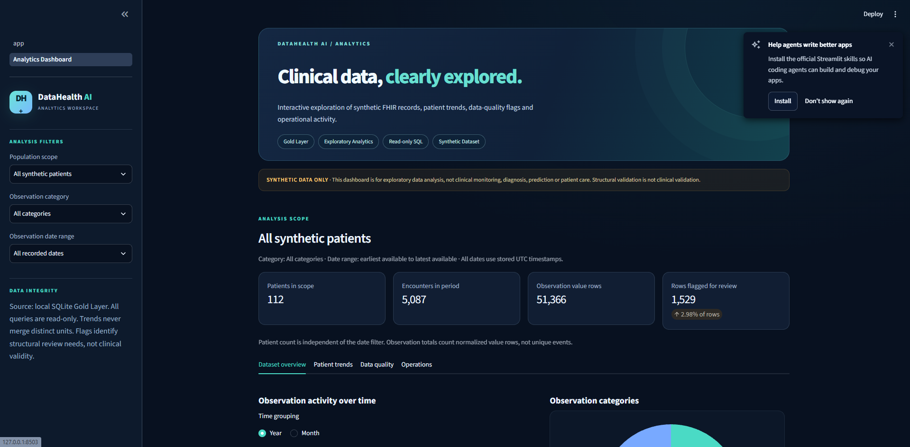
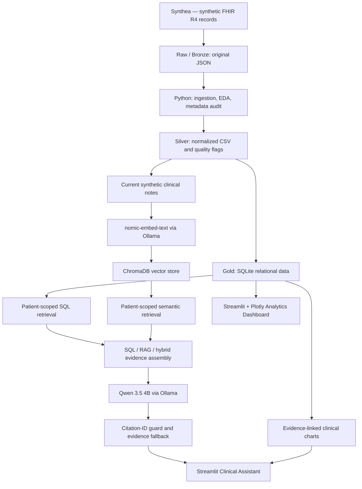

# DataHealth AI

**Data that connects. Insights you can trace.**

**DataHealth AI** is an educational, locally operated clinical-data intelligence platform that combines synthetic HL7 FHIR records, data-quality workflows, relational analytics, retrieval-augmented generation (RAG), and a source-aware language model in an interactive Streamlit workspace.

> [!IMPORTANT]
> **Synthetic data only.** This is a research/portfolio prototype, **not** a clinical decision-support system. It must not be used for diagnosis, treatment, patient monitoring, or decisions about real people. Structural checks and valid citation IDs do not establish clinical correctness.

**Current status:** functional **local** proof of concept · source repository available on GitHub · **not yet hosted as a public web application**.

## Why this project exists

The fictional **DataHealth** organization needs to make healthcare information easier to integrate, audit, explore, and retrieve. Its proposed enterprise problem spans heterogeneous sensor readings, clinical records, data shared across care systems, and operational events. Fragmentation, processing costs, and latency can make a unified view difficult to obtain.

This implementation deliberately focuses on an **offline, synthetic-data proof of concept**: ingesting selected FHIR resources, preserving their metadata, supporting patient-scoped SQL and document search, and explaining retrieved evidence through a local LLM. It **does not yet** implement live sensor ingestion, hospital integrations, stream processing, or a predictive patient-risk model.

## Application preview

### Clinical Assistant

Select a synthetic patient, ask questions in English, choose SQL/RAG/hybrid retrieval (or automatic routing), and inspect the cited records and quality flags.


### Analytics Dashboard

Explore population-wide or patient-filtered synthetic data, with observation activity, measurement categories, patient trends, data-quality findings, and operational summaries.



### Evidence-linked measurement charts

For supported structured answers, the assistant offers a history chart queried **directly from SQLite**. Chart values are **not** inferred from LLM-generated text. Measurements with different codes or units are not silently combined.


*Screenshots show a local synthetic-data demonstration and may differ slightly from later versions.*

## Core capabilities

| Area | Implemented behavior |
|---|---|
| **FHIR engineering** | Parse selected Synthea FHIR R4 resources into consistent patient, encounter, observation, condition, diagnostic-report, medication-request, and document tables. |
| **Metadata and quality** | Preserve source traceability and flag missing or mixed unit codings; avoid automatic clinical recoding when semantics are uncertain. |
| **Gold analytics** | Read-only, predefined SQLite queries and interactive Plotly charts. |
| **Document RAG** | Index selected **current** synthetic clinical documents with `nomic-embed-text` and ChromaDB; filter retrieval by patient. |
| **Clinical Assistant** | Generate English responses with **Qwen 3.5 4B** through locally running Ollama, grounded in retrieved SQL and/or RAG evidence. |
| **Citation reliability** | Check whether displayed source-marker IDs exist in retrieved evidence; retry once and use an evidence-only fallback if validation still fails. |
| **Evaluation** | Capture response time, retrieval counts, citation-marker errors, and human-reviewed factual/citation assessments. |

Patient selection and ID filtering in this demo are **not a substitute for real authentication or authorization**.

## System architecture



**Data layout:** raw FHIR files (`data/raw`) → transformed CSVs (`data/processed/fhir`) → structurally reviewed Silver data (`data/silver/fhir`) → SQLite Gold database (`data/gold/datahealth.db`). A separate ChromaDB index (`data/vectorstore/chroma`) holds document embeddings. All are **local runtime artifacts** and are excluded from the initial source repository.

See [architecture overview source](docs/architecture_overview.mmd), [Gold Layer design](docs/gold_layer_design.md), [RAG architecture](docs/rag_architecture.md), and [deployment readiness](docs/deployment_readiness.md).

## Technology stack

| Layer | Technologies |
|---|---|
| Source interoperability | **HL7 FHIR R4**, Synthea synthetic patient records, JSON |
| Engineering and validation | **Python 3.12**, standard-library CSV/JSON tools, metadata audits, `unittest` |
| Analytics storage | **SQLite** (local relational Gold Layer) |
| Semantic search | **ChromaDB**, **nomic-embed-text** |
| Language-model inference | **Qwen 3.5 4B**, **Ollama** (local) |
| UI and visualization | **Streamlit**, **Plotly**, custom CSS |
| Source control | **Git**, GitHub |

**Planned, not implemented in this local prototype:** Apache Kafka, Apache Spark, managed Azure/AWS services, Power BI integration, real-time device streams, clinical prediction models, and production-grade access controls.

## Experimental data processing results

The following figures describe **one local run** on an independently obtained Synthea FHIR sample. They are not guaranteed outputs for a different dataset or generation seed.

| Indicator | Local result |
|---|---:|
| Synthetic patients | **112** |
| FHIR resources audited | **98,573** |
| Encounters | **5,087** |
| Original FHIR `Observation` resources | **34,024** |
| Normalized observation-value rows | **51,366** |
| Observation-value rows flagged for review | **1,529** (about **2.98%**) |
| Current synthetic documents indexed | **112** |
| ChromaDB text chunks indexed | **198** |

The 1,529 flagged rows reflect **structural/semantic review flags**, not 1,529 proven clinical errors. Source values were retained, and uncertain unit conversions were not automated. Current-document selection does not establish permission to access real medical information.

## LLM evaluation: small exploratory study

Two experimental runs used the **same six prompts for one synthetic patient**. Five prompts produced answers; one medication-related SQL query had no eligible evidence, so the model was not asked to invent a response.

| Metric | Phase 8 baseline | Phase 8.1 citation guard |
|---|---:|---:|
| Unknown source-marker IDs in displayed answers | **2** | **0** |
| Answers provisionally rated fully correct | **2 / 5** | **3 / 5** |
| Answers with fully supported citations (manual review) | **3 / 5** | **3 / 5** |
| Provisionally unsupported/unclear claim groups | **6 / 47** | **2 / 47** |
| Mean total time for generated/validated answers | **6.634 s** | **5.799 s** |

**Interpretation:** exact citation-ID hygiene improved in this matched experiment. These tiny, reviewer-dependent samples **cannot establish a general factual accuracy rate, clinical safety level, calibrated hallucination rate, or performance advantage**. In particular, an existing citation ID does not prove that the referenced evidence supports each sentence.

Known review limitations include statements that imply a structured table was checked during a RAG-only query, and ambiguous grouping of vaccine terms from a clinical note. See [evaluation methodology](docs/llm_evaluation_methodology.md) and [citation policy](docs/reliability_citation_policy.md).

## Run locally (Windows PowerShell)

The repository contains **source code and tests**, but **does not ship** the Synthea data, generated SQLite database, Chroma index, or Ollama model files. The procedure below assumes permission to obtain the synthetic sample and enough local disk/memory resources.

### 1. Clone and prepare the Python environment

```powershell
git clone https://github.com/LucaBarsi/DataHealth-AI.git
cd DataHealth-AI
py -3.12 -m venv .venv
.\.venv\Scripts\python.exe -m pip install --upgrade pip
.\.venv\Scripts\python.exe -m pip install -r requirements_local.txt
```

### 2. Install and prepare local Ollama models

Install [Ollama](https://ollama.com/download) on Windows, then run:

```powershell
ollama pull qwen3.5:4b
ollama pull nomic-embed-text
ollama list
```

Ollama should be running locally before you build the vector index or ask questions.

### 3. Obtain and transform synthetic FHIR data

Download a compatible **FHIR R4** sample from the [Synthea downloads page](https://synthetichealth.github.io/downloads.html), extract its JSON files to `data/raw/synthea_sample_data_fhir_latest/`, and confirm that the directory contains the synthetic patient bundles. The sample is not included here.

From the project root:

```powershell
.\.venv\Scripts\python.exe -m src.transform_fhir --input "data/raw/synthea_sample_data_fhir_latest" --output "data/processed/fhir"
.\.venv\Scripts\python.exe -m src.build_silver --input "data/processed/fhir" --output "data/silver/fhir" --reports "reports/silver"
.\.venv\Scripts\python.exe -m src.build_gold --input "data/silver/fhir" --output "data/gold/datahealth.db" --reports "reports/gold"
```

These scripts prepare **selected** FHIR resources; they are not a complete FHIR-conformance validator or enterprise ingestion service. If you use a different dataset, expect different counts and metadata findings.

### 4. Create the local document index

```powershell
.\.venv\Scripts\python.exe -m src.rag_assistant index --silver "data/silver/fhir" --database "data/gold/datahealth.db" --index-dir "data/vectorstore/chroma" --reports "reports/rag"
```

Only eligible current synthetic documents are indexed by default. The index can be rebuilt if source data or the embedding model changes; see [RAG notes](docs/rag_architecture.md).

### 5. Start the application

```powershell
.\.venv\Scripts\python.exe -m streamlit run Clinical_Assistant.py --server.address 127.0.0.1
```

Open the local URL shown in the terminal (typically `http://127.0.0.1:8501`); then navigate between **Clinical Assistant** and **Analytics Dashboard**. The port can differ if another Streamlit instance is running.

### 6. Run tests and review quality reports

```powershell
.\.venv\Scripts\python.exe -m unittest discover -s tests -p "test_repository_preflight.py" -v
.\.venv\Scripts\python.exe -m unittest discover -s tests -p "test_reliable_assistant.py" -v
.\.venv\Scripts\python.exe -m unittest discover -s tests -p "test_analytics_backend.py" -v
```

These tests cover selected components and often use synthetic fixtures or mocked model responses. They **do not** establish end-to-end clinical reliability. For generated quality reports, refer to the `reports/` folder in your own local run; this folder is intentionally not published in the repository.

## Repository structure

```text
DataHealth-AI/
├── Clinical_Assistant.py           # Main Streamlit entry point
├── pages/
│   └── 1_Analytics_Dashboard.py    # Interactive analytics workspace
├── src/                            # FHIR ETL, SQL, RAG, evaluation, UI backends
├── scripts/                        # Repository publication preflight
├── tests/                          # Automated component tests
├── sql/                            # Query examples
├── assets/
│   ├── datahealth.css
│   ├── analytics_dashboard.css
│   └── screenshots/                # This README update
├── docs/                           # Architecture, mapping, QA and safety notes
├── requirements_local.txt
└── README.md
```

## Security, limitations and deployment

- **Synthetic data only.** Never upload real patient records into this educational demo or commit local clinical data, model files, credentials, `.venv/`, or runtime databases.
- **Patient-scoped retrieval is not access control.** An internet-facing healthcare application would require identity verification, authorization, secure secrets handling, audit logging, rate limits, and privacy/legal review.
- **No medical decision support.** The system does not diagnose, prescribe, clinically validate observations, or train a predictive disease model.
- **Not yet cloud-deployable as-is.** Public hosting requires an accessible, protected inference service, a reproducible synthetic data store, vector persistence, configuration management, and independent testing. See [deployment notes](docs/deployment_readiness.md).
- **Licensing:** no project license has been selected in this source release. Do not assume unrestricted reuse rights; check the licenses of dependencies and source data separately.

## Roadmap

- [x] FHIR-derived Bronze/Silver/Gold-inspired local pipeline
- [x] Structural quality flags and patient-linked SQL retrieval
- [x] Local Qwen + ChromaDB RAG and citation-ID validation
- [x] Streamlit Clinical Assistant, analytics dashboard, and contextual charts
- [x] Initial unit tests and small manually reviewed LLM evaluation
- [ ] Broader multi-patient evaluation, claim-level citation checks and terminology cleanup
- [ ] Fully reproducible public synthetic demo dataset and automated CI checks
- [ ] Protected hosted inference + database/vector services for a public demonstration
- [ ] Streaming ingestion with Kafka and scalable processing with Spark
- [ ] Azure/AWS architecture deployment and Power BI reporting
- [ ] A clearly scoped predictive ML use case with appropriate labels and evaluation

## Acknowledgments

- [Synthea](https://github.com/synthetichealth/synthea) — synthetic health-record generation.
- [HL7 FHIR R4](https://hl7.org/fhir/R4/) — healthcare interoperability specification.
- [Ollama](https://ollama.com/), [ChromaDB](https://www.trychroma.com/), [Streamlit](https://streamlit.io/) and [Plotly](https://plotly.com/) — model runtime, retrieval and UI tooling.

---

**Project repository:** [DataHealth-AI](https://github.com/LucaBarsi/DataHealth-AI) · **Current scope:** local educational prototype, synthetic records only.
