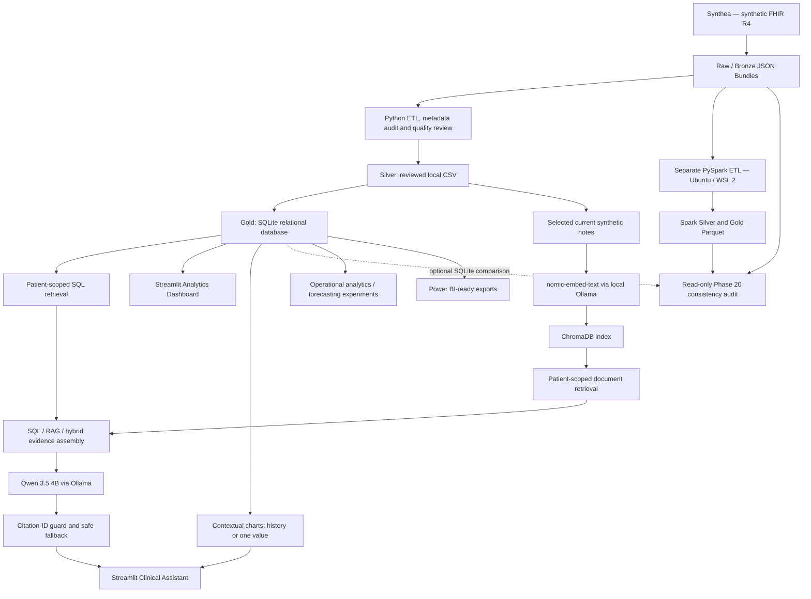

# DataHealth AI

**Data that connects. Insights you can trace.**

**DataHealth AI** is an educational, local-first clinical-data intelligence prototype built around **synthetic HL7 FHIR R4 data**. It combines quality-aware data engineering, a relational Gold Layer, patient-scoped SQL and document retrieval, a locally run language model, analytics, and exploratory operational forecasting in a Streamlit workspace.

> [!IMPORTANT]
> **Synthetic data only.** This is a research and portfolio project, **not** a clinical decision-support system. Do not use it to diagnose, treat, monitor, or make decisions about real people. Passing structural checks and finding valid citation IDs do **not** establish clinical correctness.

**Project status (Phase 22 review):** functional **local** prototype with a separate Ubuntu/WSL Spark workflow; documentation and release-readiness work is ongoing. The source repository may not yet include the latest uncommitted changes. **No public web deployment** is claimed.

## Why this project exists

The fictional **DataHealth** organization represents a common health-data challenge: records, measurements, documents, and operational events are dispersed across systems. This prototype explores how to ingest a synthetic FHIR sample, preserve provenance and quality indicators, retrieve patient-specific evidence, and present interpretable analytics **without using real patient information**.

The project has a local engineering pipeline and an independent Spark/Parquet experimentation path. It does **not** ingest live sensors, integrate with actual hospitals, use Kafka streaming, or deploy managed Azure/AWS services.

## Application preview

### Clinical Assistant

Select one synthetic patient, ask a question in English, use SQL/RAG/hybrid retrieval (or automatic routing), and inspect cited evidence with quality flags. Responses use a locally running **Qwen 3.5 4B** model through **Ollama**.


### Analytics Dashboard

Explore aggregate or patient-filtered synthetic records, observation activity, measurement categories, data-quality findings, and operational summaries.


### Evidence-linked contextual measurements — Phase 21

For eligible structured answers, the Clinical Assistant re-queries **read-only SQLite Gold Layer data** instead of plotting numbers produced by the LLM. Results are restricted to the selected synthetic patient and grouped by **measurement code and unit**:

- **Two or more eligible observations:** an interactive time-series chart.
- **One eligible observation:** a single-value display with unit, UTC date/time, quality status, and observation ID; no trend is implied.
- **No eligible observations:** an explanation rather than a fabricated chart.
- Records marked `REVIEW_REQUIRED` are **excluded by default** and included only when the user enables the review filter.


*Existing screenshot paths are retained from the earlier README. Verify that all referenced image files are present and reflect the latest UI before publication.*

### Operational ML forecasting — Phase 18

The project includes a **local exploratory workload-forecasting** module and Streamlit ML Forecasting page (`src/workload_forecast.py` and `pages/2_ML_Forecasting.py`). This work concerns operational aggregates; it is **not** a clinical prediction or patient-risk model. See [Phase 18 notes](docs/development_history/README_PHASE18.md) and [forecasting methodology](docs/phase18_workload_forecasting.md).

## Implemented capabilities and scope

| Area | What is present in the local project | Important boundary |
|---|---|---|
| **FHIR ingestion and quality** | Selected Synthea FHIR R4 resources, metadata auditing, Python transformations, structural review flags | Not complete FHIR conformance or clinical validation |
| **Gold Layer and analytics** | Relational SQLite database, predefined patient-scoped/read-only SQL queries, Streamlit and Plotly dashboards | No multi-user access control |
| **Document RAG** | Selected current synthetic notes, `nomic-embed-text` embeddings via Ollama, ChromaDB, patient-scoped retrieval | Source retrieval alone does not prove each answer is correct |
| **Source-aware assistant** | Qwen 3.5 4B with SQL, RAG, and hybrid retrieval; citation-ID checks and evidence-only fallback | Citation-ID validity is not claim-level factual validation |
| **Contextual charts (Phase 21)** | Evidence-linked measurement history, single-observation summary, unit isolation and quality filter | No clinical interpretation of values |
| **Local Spark ETL (Phase 19)** | Separate Ubuntu/WSL 2 workflow using PySpark 4.3.0 and Silver/Gold Parquet outputs | Not a production distributed cluster |
| **Pipeline consistency audit (Phase 20)** | Read-only checks comparing synthetic FHIR Bundle counts, Spark Parquet aggregates, and an optional SQLite summary | Structural/count consistency, not clinical correctness |
| **Operational forecasting (Phase 18)** | Local ML experimentation and dashboard page | Not patient-level risk prediction |
| **Power BI preparation** | Export module and guidance for downstream reporting | Does not mean a Power BI dashboard or service is deployed |
| **Cloud Demo / retrieval benchmarks** | Local evaluation and optional hosted-inference-oriented code paths, including semantic retrieval experiments | Not evidence of a managed cloud deployment |

## System architecture

The two engineering paths are deliberately shown separately: the **Python/SQLite application pipeline** and the **Spark/Parquet validation workflow**. They are not represented as a single production lakehouse.



The source diagram is available at [`docs/architecture_overview.mmd`](docs/architecture_overview.mmd). Diagram edges are a high-level explanation; they are **not** evidence of a cloud deployment or a live streaming architecture.

**Local data layout:** `data/raw/` (source Bundles) → `data/processed/fhir/` (Python transformed data) → `data/silver/fhir/` (reviewed data) → `data/gold/datahealth.db` (SQLite). The separate Spark workflow writes Silver/Gold Parquet artifacts, documented in [Phase 19](docs/development_history/README_PHASE19_SPARK.md). The ChromaDB index is stored locally under `data/vectorstore/chroma/`. Runtime data and generated reports are excluded from Git.

## Technology stack

| Component | Technologies / environment |
|---|---|
| Data source | Synthea, HL7 FHIR R4, JSON |
| Windows application | Python 3.12, Pandas, NumPy, SQLite, Streamlit, Plotly, Matplotlib |
| AI and retrieval | Ollama, Qwen 3.5 4B, `nomic-embed-text`, ChromaDB; FastEmbed in selected Cloud Demo/benchmark paths |
| ML experimentation | Scikit-learn and project-specific forecasting modules |
| Spark workflow | Ubuntu on WSL 2, PySpark 4.3.0, compatible Java runtime, Parquet |
| Evaluation and versioning | `unittest`, Git, GitHub |

**Not implemented as production integrations:** Apache Kafka, live device streaming, hospital APIs, managed Azure/AWS deployment, hosted Power BI Service, and production-grade authentication/authorization. There is **no predictive patient-risk model** in this prototype.

## Experimental results — one synthetic dataset

These numbers refer to **one local run**, not guaranteed values for a different Synthea sample or random seed.

| Indicator | Local result |
|---|---:|
| Synthetic patients | **112** |
| FHIR resources audited | **98,573** |
| Encounters | **5,087** |
| Original FHIR `Observation` resources | **34,024** |
| Normalized observation-value rows | **51,366** |
| Rows flagged for review | **1,529** (approximately **2.98%**) |
| Selected current synthetic documents indexed | **112** |
| ChromaDB text chunks indexed | **198** |

Review flags identify **potential structural or semantic issues**, not proven medical errors. Source values are retained; uncertain unit conversions are not applied automatically.

## LLM evaluation — small exploratory study

Two early experiments used the **same six prompts for one synthetic patient**. Five prompts produced answers; one query had no eligible evidence.

| Metric | Phase 8 baseline | Phase 8.1 citation guard |
|---|---:|---:|
| Unknown source-marker IDs in displayed answers | **2** | **0** |
| Answers provisionally rated fully correct | **2 / 5** | **3 / 5** |
| Answers with fully supported citations (manual review) | **3 / 5** | **3 / 5** |
| Provisionally unsupported/unclear claim groups | **6 / 47** | **2 / 47** |
| Mean total time for generated/validated answers | **6.634 s** | **5.799 s** |

These results are **not** a general accuracy estimate, a calibrated hallucination rate, or evidence of clinical safety. For methodology, see [LLM evaluation](docs/llm_evaluation_methodology.md) and [citation policy](docs/reliability_citation_policy.md).

## Run locally

The source repository does **not** provide synthetic FHIR source files, generated databases, Chroma indexes, Ollama model weights, or reports. Recreate these locally from a compatible Synthea FHIR R4 sample. The steps below reflect the existing project documentation and **have not yet been validated from a completely clean machine**.

### Windows — application and local AI

Use PowerShell from the repository root with Python **3.12**:

```powershell
git clone https://github.com/LucaBarsi/DataHealth-AI.git
cd DataHealth-AI
py -3.12 -m venv .venv
.\.venv\Scripts\python.exe -m pip install --upgrade pip
.\.venv\Scripts\python.exe -m pip install -r requirements.txt
```

`requirements.txt` is a **range-based dependency manifest**, not a fully pinned lockfile. The original phase-specific requirements are kept for auditability. A clean install, including optional benchmark paths, is still part of Phase 22 release validation.

Install and start [Ollama](https://ollama.com/download), then download the required local models:

```powershell
ollama pull qwen3.5:4b
ollama pull nomic-embed-text
ollama list
```

Obtain a compatible **Synthea FHIR R4 sample** (see [Synthea downloads](https://synthetichealth.github.io/downloads.html)) and place its JSON Bundles in `data/raw/synthea_sample_data_fhir_latest/`. Then create the local Gold Layer:

```powershell
.\.venv\Scripts\python.exe -m src.transform_fhir --input "data/raw/synthea_sample_data_fhir_latest" --output "data/processed/fhir"
.\.venv\Scripts\python.exe -m src.build_silver --input "data/processed/fhir" --output "data/silver/fhir" --reports "reports/silver"
.\.venv\Scripts\python.exe -m src.build_gold --input "data/silver/fhir" --output "data/gold/datahealth.db" --reports "reports/gold"
```

Create the local document index:

```powershell
.\.venv\Scripts\python.exe -m src.rag_assistant index --silver "data/silver/fhir" --database "data/gold/datahealth.db" --index-dir "data/vectorstore/chroma" --reports "reports/rag"
```

Start the local interface:

```powershell
.\.venv\Scripts\python.exe -m streamlit run Clinical_Assistant.py --server.address 127.0.0.1
```

Use the Streamlit navigation to access **Clinical Assistant**, **Analytics Dashboard**, and **ML Forecasting**. Local model inference requires Ollama to be running. Keep the application on localhost and never load real patient data.

### Ubuntu / WSL 2 — separate Spark environment

The Spark path is **not** required for launching the Windows Clinical Assistant. The project-specific Spark ETL tests passed on Ubuntu/WSL 2 with PySpark **4.3.0**. Use a **separate Linux virtual environment** and a compatible Java runtime; do not reuse the Windows `.venv`.

From the Ubuntu shell, use the corresponding WSL-mounted path to your own clone:

```bash
cd /mnt/c/path/to/DataHealth-AI
source ~/datahealth-spark-venv/bin/activate
python -m unittest discover -s tests -p 'test_spark_etl.py' -v
python -m unittest discover -s tests -p 'test_validate_local_pipeline.py' -v
```

For a **new** Linux virtual environment, install [`requirements-spark.txt`](requirements-spark.txt) after configuring Python and Java. For the actual ETL invocation and Parquet layout, consult [Phase 19](docs/development_history/README_PHASE19_SPARK.md). For read-only pipeline consistency checks, consult [Phase 20](docs/development_history/README_PHASE20_LOCAL_INTEGRATION.md).

### Tests and validation scope

Windows example, from the project root:

```powershell
.\.venv\Scripts\python.exe -m pip check
.\.venv\Scripts\python.exe -m unittest discover -s tests -p "test_contextual_charts.py" -v
.\.venv\Scripts\python.exe -m unittest discover -s tests -p "test_analytics_backend.py" -v
```

**Observed recent checks:** 11/11 contextual-chart unit tests passed after the Phase 21 UI revision; 3/3 Spark ETL tests passed on Ubuntu/WSL 2; a Windows `pip check` found no broken installed requirements. Visual checks covered vital-sign and laboratory charts, one-point presentation, and opt-in quality flags. These checks do **not** replace a clean installation, a full cross-environment regression run, or an independent clinical evaluation. A broad Windows test run encountered a native Hadoop compatibility issue in the Spark tests.

## Repository layout

```text
DataHealth-AI/
├── Clinical_Assistant.py
├── app.py
├── pages/
│   ├── 1_Analytics_Dashboard.py
│   └── 2_ML_Forecasting.py
├── src/                      # ETL, SQL, AI/retrieval, analytics, forecasting, Spark
├── cloud_demo/               # Evaluation/benchmarks and optional demo backends
├── tests/                    # Automated tests
├── scripts/                  # Project utilities
├── sql/                      # SQL examples
├── assets/                   # UI styling and optional screenshots
├── docs/                     # Detailed architecture, QA, evaluation notes
├── requirements.txt          # Windows application (Phase 22)
├── requirements-spark.txt    # Ubuntu/WSL Spark (Phase 22)
├── requirements_phase*.txt   # Historical dependency manifests
└── README.md
```

Generated `data/` and `reports/` directories are intentionally excluded from Git. These are **runtime artifacts**, not public datasets shipped with the source repository.

## Technical documentation

| Topic | Reference |
|---|---|
| Current architecture source | [Architecture overview](docs/architecture_overview.mmd) |
| Relational Gold Layer | [Gold Layer design](docs/gold_layer_design.md) |
| RAG implementation | [RAG architecture](docs/rag_architecture.md) |
| ML forecasting | [Phase 18](docs/development_history/README_PHASE18.md) and [methodology](docs/phase18_workload_forecasting.md) |
| Local Spark Parquet workflow | [Phase 19](docs/development_history/README_PHASE19_SPARK.md) |
| Cross-pipeline consistency | [Phase 20](docs/development_history/README_PHASE20_LOCAL_INTEGRATION.md) |
| Evidence-linked charts | [Phase 21 validation](docs/development_history/PHASE21_CONTEXTUAL_CHARTS_VALIDATION.md) |
| Downstream Power BI preparation | [Power BI guide](docs/development_history/README_POWER_BI.md) |
| Security and deployment | [Deployment readiness](docs/deployment_readiness.md) |

Earlier `README_PHASE*.md` documents remain in the repository as a development history. Documentation files must be staged, link-checked, and reviewed before publication; Git currently has local untracked content from recent phases.

## Security, limitations, and release readiness

- **Synthetic data only.** Do not include real patient information, secret tokens, `.env`, local database/index files, reports, or generated datasets in the Git repository.
- **Not patient authentication.** Selecting a patient ID and scoping retrieval in a local demo are **not** substitutes for authorization, identity verification, auditing, privacy controls, or secure internet-facing deployment.
- **Citation and quality caveats.** Citation IDs indicate reference identity, not support for every generated claim; structural checks do not establish clinical correctness.
- **No hosted app.** The local Ollama + SQLite + ChromaDB configuration is not an internet-ready deployment. Managed cloud infrastructure and live streaming remain future work.
- **Reproducibility incomplete.** Phase 22 still needs link verification, clean install tests, a consolidated release check, and explicit review of Git changes before publishing.
- **License:** no project software license has yet been selected; review code, data, and dependency licenses before claiming unrestricted reuse rights.

## Roadmap

- [x] Local FHIR-derived Bronze / Silver / SQLite Gold pipeline
- [x] Quality flags, patient-scoped SQL and RAG, citation-ID checks
- [x] Clinical Assistant, Analytics Dashboard, contextual charts (Phase 21)
- [x] Local Spark/Parquet path and integration-audit implementation (Phases 19–20)
- [x] Operational forecasting prototype and Power BI-ready export tooling
- [x] Separate Windows / WSL requirements manifests (Phase 22, initial draft)
- [ ] Clean installation and cross-environment regression validation
- [ ] Reconcile and organize all README files, links, and screenshots
- [ ] Broader multi-patient, claim-level AI evaluation
- [ ] Protected public demo deployment, if pursued
- [ ] Kafka streaming and managed Azure/AWS architecture, if pursued
- [ ] Production-grade access controls and legal/security review for any real-world use

## Acknowledgments

- [Synthea](https://github.com/synthetichealth/synthea) — synthetic health-record generation.
- [HL7 FHIR R4](https://hl7.org/fhir/R4/) — healthcare interoperability specification.
- [Ollama](https://ollama.com/), [ChromaDB](https://www.trychroma.com/), [Streamlit](https://streamlit.io/), [Plotly](https://plotly.com/), and [Apache Spark](https://spark.apache.org/) — major components of the local experimentation stack.

---

**Project repository:** [DataHealth-AI](https://github.com/LucaBarsi/DataHealth-AI) · **Scope:** local educational prototype using synthetic records only.
