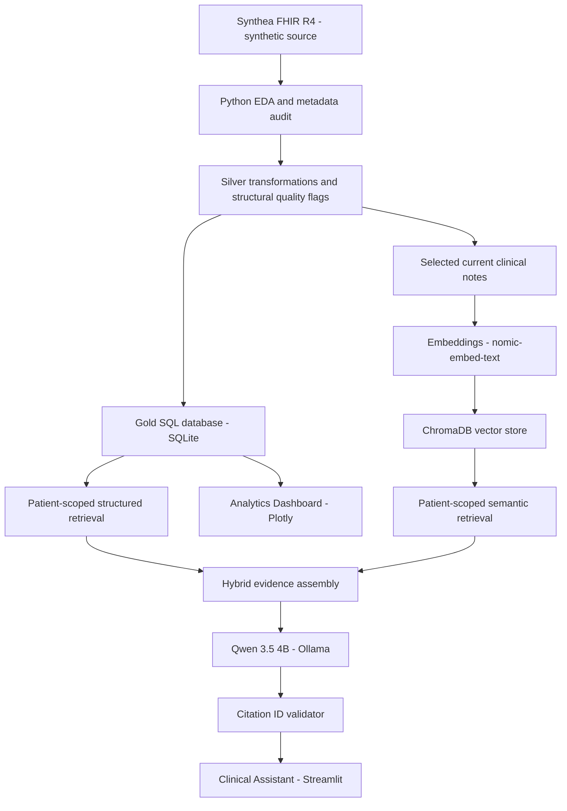

# DataHealth AI

**Data that connects. Insights you can trace.**

An educational **clinical data intelligence** prototype that combines interoperable synthetic FHIR records, data engineering, structured SQL retrieval, document RAG and a local open-weight LLM.

> **Synthetic data only.** This project is not approved for clinical use, diagnosis, treatment, patient care or decisions involving real people. Citation identifiers do not establish factual or clinical validity.

## What it does

- Processes synthetic **Synthea FHIR R4** records into a Bronze/Silver/Gold-inspired local pipeline.
- Preserves patient-scoped links between observations, encounters, conditions, diagnostic reports and medication requests.
- Flags clinical coding and unit inconsistencies without automatically rewriting uncertain values.
- Retrieves structured evidence from **SQLite** and selected current clinical notes from **ChromaDB**.
- Uses **Qwen 3.5 4B via Ollama** to answer grounded, patient-scoped questions in English.
- Checks that displayed citation IDs correspond to retrieved source identifiers.
- Provides an interactive **Clinical Assistant** and **Analytics Dashboard** in Streamlit.

## Architecture



The Azure/AWS, Kafka, Spark and Power BI components belong to the **planned enterprise architecture** and are not claimed to be implemented in this local proof of concept.

## Technology

Python 3.12 · HL7 FHIR R4 · Pandas · SQLite · ChromaDB · Ollama · Qwen 3.5 4B · nomic-embed-text · Streamlit · Plotly · unittest

## Prototype results (limited scope)

The synthetic dataset processed in the local experiment contained 112 unique patients, 98,573 FHIR resources and 51,366 normalized observation-value rows. A structural review flagged 1,529 rows for further inspection. The indexed RAG collection included 112 selected current documents split into 198 chunks.

In a **small experimental manual review of five generated answers**, three were classified as fully correct and the exact citation-ID validator displayed no unknown references. This is **not** a clinical accuracy estimate, a general hallucination rate or a substitute for independent validation.

## Run locally

The published source repository **does not include** raw, processed, Silver/Gold clinical datasets, the ChromaDB index or local model files. Recreate these from the independently obtained synthetic Synthea sample using the project’s documented pipeline before running the application.

Create a Python 3.12 environment and install the documented local requirements. Run Ollama locally with `qwen3.5:4b` and `nomic-embed-text`, then start the interface from the project root:

```powershell
.\.venv\Scripts\python.exe -m streamlit run Clinical_Assistant.py --server.address 127.0.0.1
```

The **Analytics Dashboard** is available in the Streamlit page navigation.

## Public deployment status

**Source publication readiness is in progress. This is not yet a hosted application.** The working app requires a local SQLite Gold Layer, local ChromaDB and a local Ollama endpoint. A public deployment needs a separate hosted model/data architecture and a security review. See `docs/deployment_readiness.md`.

## Data and safety

Only synthetic demonstration data is used. Original synthetic source records remain outside the public source repository. Records marked for semantic review are not clinically validated, and the assistant cannot independently establish medical validity.

## License

A software license has not yet been selected; review code, dataset and dependency licenses before publishing a license file or claiming open-source reuse rights.
