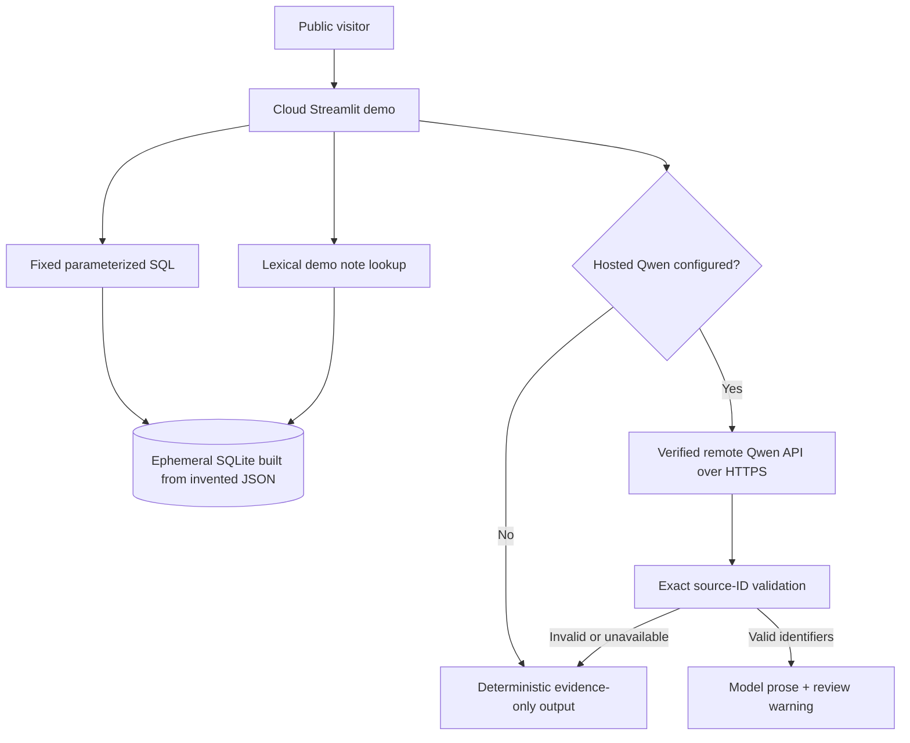

# DataHealth AI — Public Demo & Cloud Deployment Plan

## Architecture decision: isolated deployment mode

The existing local research workspace is preserved and remains the canonical demonstration of FHIR ingestion, Bronze/Silver/Gold transformations, local Gold SQLite, Ollama Qwen 3.5 4B, ChromaDB vector RAG, SQL/RAG routing, citation guardrails, and the interactive Streamlit dashboard.

A separate `cloud_demo/streamlit_app.py` is the deployment entrypoint for a **lightweight public preview**. This minimizes deployment risk and prevents accidental exposure of local files. Its fixtures are hand-authored, not extracted or copied from the local Synthea dataset.

## Why this is not the full enterprise deployment

The public demo replaces local ChromaDB vector retrieval with a small lexical lookup and local Synthea data with separately authored fixtures. It does not demonstrate Kafka streaming, Spark scale-out, Azure/AWS infrastructure, FHIR interoperability across institutions, authentication, PHI management, or production-grade auditing.

### Future work for a hosted full-feature prototype

1. Define an **access control model** with authentication and session authorizations before handling actual healthcare data.
2. Use separate hosting for any Qwen inference server or a verified hosted Qwen API. Do not tunnel an unauthenticated local Ollama server to the public internet.
3. Move structured data to managed SQL and vector collections to persistent managed storage or controlled persistent services. Do not depend on Streamlit local ephemeral files.
4. Move ingestion / batch jobs out of interactive Streamlit requests and add Azure/AWS storage, Kafka/Spark only when dataset scale and project objectives justify them.
5. Establish monitoring, rate limiting, latency/error budgets, audit logs, key rotation, and privacy/security review.
6. Evaluate retrieval accuracy, claim-level citation support, demographic bias, and robustness with larger synthetic test sets.
7. Keep local mode usable for reproducible portfolio demonstrations.

## Threat & privacy boundaries

- Public app input is **not real patient data**. The demo should clearly warn visitors not to paste protected information into queries.
- Public requests to a hosted model send prompt text and illustrative retrieved evidence to that third-party provider. Verify provider privacy/retention before activation.
- The code enforces a small per-session hosted-call limit, but a public application would require provider-side global quotas, authentication, and monitoring for spending control.
- A returned citation ID's presence does not prove factual support for each claim.
- Secrets belong only in Streamlit Community Cloud settings or a local ignored secrets file, never in Git commits.
