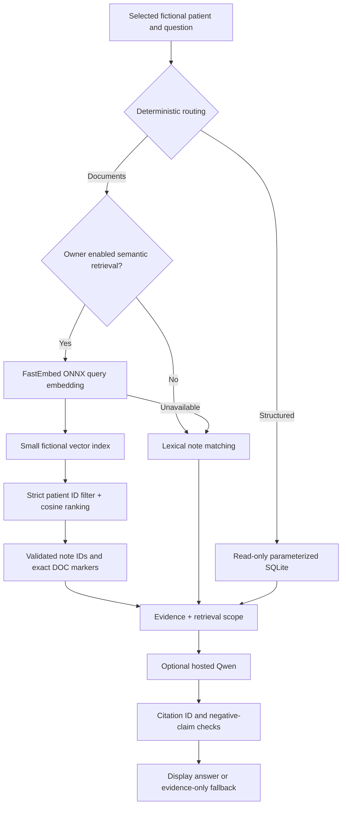

# Phase 17 — Optional Semantic Note Retrieval (Cloud Demo)

## Business problem

Keyword matching alone can miss relevant fictional clinical notes when a visitor asks a question using terms absent from the source text. A compact dense vector index makes it possible to rank notes by embedding similarity while preserving the existing read-only structured SQL workflow.

## Scope and non-goals

**In scope:** illustrative fixed notes, ONNX sentence embeddings, patient-level filtering, cosine ranking, a source-validated JSON index, exact citation IDs, and a documented lexical fallback.

**Not in scope:** importing Synthea records into the Cloud Demo, authenticating real patients, actual clinical guidance, full ChromaDB replication, automatic inference of diagnosis, clinical validation, guaranteed improvement in retrieval quality, or a hosted embedding service.

## Architecture

## Index schema and persistence

The `cloud_demo/semantic_index.json` file contains a stable schema marker, an embedding model identifier, a SHA-256 digest of **fictional** note content and metadata, vector dimensions, and one normalized vector per note. No raw note texts, authentic records, or credentials are included. Existing note references retain the precise format `[DOC:DEMO-D001#chunk:0]`.

A local developer generates this file using `python -m cloud_demo.semantic_retrieval build`. Committing that small index makes it available after Cloud redeployment. The ONNX embedding model is downloaded/cached separately at runtime; Streamlit's ephemeral filesystem **does not guarantee a durable model cache or locally generated index**.

## Safety controls

1. Source data loader explicitly accepts only `synthetic_only` fixture data with `DEMO-P*` patient IDs.
2. Index validator checks the complete fictional corpus fingerprint, embedding dimension, model name and every patient-to-document mapping.
3. Query embedding is calculated on the Streamlit server, not sent to another embeddings vendor.
4. The search filters the index to the selected patient **before** ranking or returning notes.
5. Backend intersects semantic result IDs with note IDs retrieved for that same patient through SQL, rejecting stray IDs.
6. Retrieved source markers remain compatible with existing exact-citation and negative-claim validation. Retrieval similarity **is not proof of factual entailment**.
7. A missing ONNX model, invalid index or query-level embedding failure falls back to lexical matching and is signaled in the UI.
8. Owner-controlled `SEMANTIC_RAG_ENABLED` prevents automatic model downloads and high CPU usage by anonymous visitors before testing.

## Current small corpus limitation

With **one document per fictional patient**, semantic ranking cannot demonstrate an accuracy benefit: the available note is often the only candidate. Offline tests use an isolated, invented two-note patient fixture to verify rank ordering. Measuring retrieval quality against labeled source relevance requires a richer, still fictional note corpus and controlled benchmarks.

## Deployment and cost

FastEmbed uses an ONNX model (`BAAI/bge-small-en-v1.5`) that can run on CPU. The model introduces installation weight and a first-use download, so Community Cloud memory, start-up and network restrictions must be checked. It does **not** use Qwen tokens for vector creation. Hosted Qwen calls remain subject to the Phase 16 budget guards and provider-side quotas.

If the model causes resource errors, set `SEMANTIC_RAG_ENABLED = "false"` in Streamlit Secrets. This will preserve the six suggested questions, Qwen and the original stable lexical search path without modifying code.

## Validation status

Offline tests verify the retrieval integration, exact marker preservation, invalid/stale index rejection, strict patient matching, lexical fallback, and latest-note behavior. Real ONNX model installation and Streamlit Cloud deployment remain to be confirmed on the user's environment. No end-to-end semantic quality claim should be made until the UI reports `semantic_vector_cosine` on document retrieval and comparative retrieval tests are reviewed.
